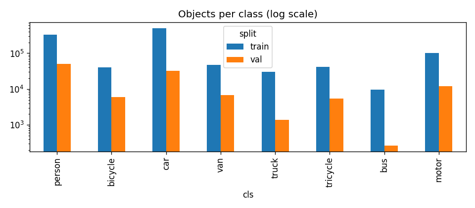
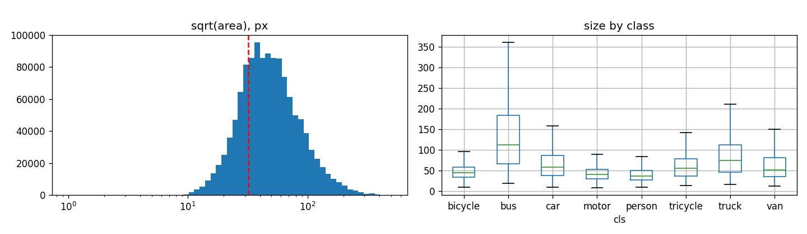
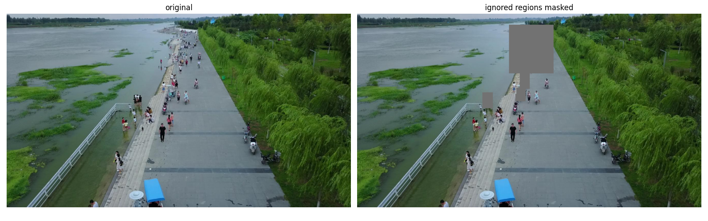
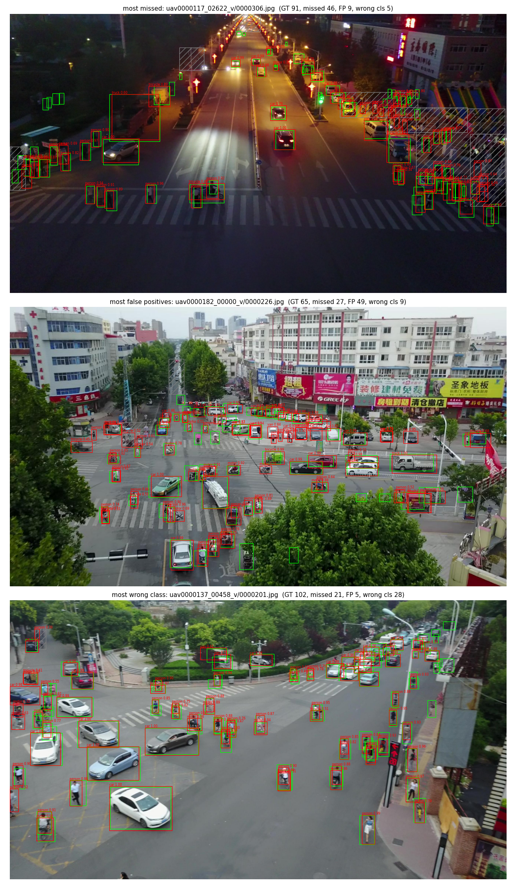
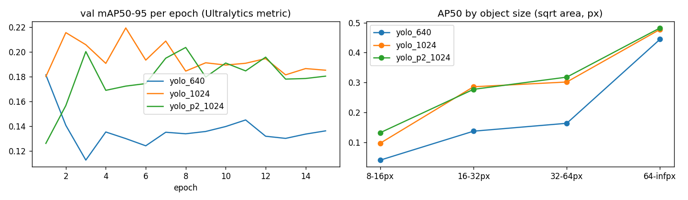

## 1. Дані і препроцесинг

Ноутбук: `notebooks/00_eda.ipynb`.

Чому ми використовуємо 1024, а не 640?
Тому що у VisDrone є дуже дрібні об'єкти, медіана типу 46 пікселів на кадрі 1920×1080, і модель їх в оригіналі просто не бачить, вона кадр стискає. При 640 кадр стискається втричі, і половина об'єктів стає меншою за 16 px, тобто це кілька пікселів, у яких нічого не розгледиш. При 1024 таких лише 1/5

| Long side | медіана об'єкта, px | < 16 px |
|---|---|---|
| 640 | 15.3 | 53.6% |
| 1024 | 24.5 | 19.9% |
| 1280 | 30.6 | 9.7% |
| 1920 | 45.9 | 1.8% |

Класи дуже незбалансовані: car 44%, person 31%, motor 9%, bus лише 0.8%. В середньому 45 об'єктів на кадр, максимум 180.

Сірі ignored-регіони і кожен п'ятий кадр. Ignored-регіони – це натовпи і парковки, де об'єкти не розмічені , їх є на 72% кадрів. Якщо їх залишити, то модель бачить там машини без розмітки і навчиться, що машина це фон. Тому ми їх зафарбовуємо сірим, а розмічені об'єкти лишаємо. В evaluation вони йдуть як `iscrowd`, тобто детекції там не штрафуються

А з кадрами: сусідні кадри відео майже однакові (той самий об'єкт між t і t+1 має IoU 0.90). 25 тисяч майже дублікатів дають мало нового, а вони тренуються в 5 разів довше. Кожен п'ятий кадр якраз і є нашим компромісом

## 2. Валідація

Ми розбиваємо по кліпах. Якщо поділити кадри випадково, у тренуванні і валідації опиняться сусідні кадри з того самого відео, тобто майже однакові картинки. Модель це запам'ятає і покаже завищений результат. Тому валідація це цілих сім кліпів, яких нема в train. Всі моделі оцінюються на одних і тих самих 571 val кадрах однаковим COCO evaluator з `src/common.py` (maxDets 500 як на лідерборді).

## 3. Детектори

Всі CNN моделі стартують з COCO-pretrained ваг, тренування на колаб гпу т4.

### 3.1 Two-stage: Faster R-CNN (`01_faster_rcnn`)

Faster R-CNN працює в 2 кроки: 
1. (RPN) швидко проходить по всьому кадру і каже, де можливий якийсь об'єкт, не розбираючи який саме. Вона відсіює очевидний фон. 
2. бере кожного кандидата, вирізає його ознаки, вирішує, що це за клас, а також уточнює рамку.

| run | зміна | mAP | AP50 | AP75 | AP_small | FPS |
|---|---|---|---|---|---|---|
| frcnn_base | defaults, anchors 32–512 | **0.232** | 0.467 | **0.200** | 0.106 | 5.0 |
| frcnn_small_anchors | anchors 16–256 | 0.228 | **0.473** | 0.190 | **0.128** | 5.1 |

ResNet-50-FPN v2, 2 epochs, SGD lr 0.01, cosine.

Маленькі анкери підняли AP_small на 21%, але bus AP впав (0.046 → 0.021), бо великим об'єктам забракло великих анкерів, тому mAP той самий. Найчастіші помилки: van → car (492 з 1009 vans), bicycle → motor (380), motor → person (320). Згори бус і машина відрізняються кількома пікселями, а людина на двох колесах виглядає однаково, плюс car в 10 разів частіший. Ще одна помилка – дрібні об'єкти просто пропускаються (AP 0.04 для 8–16 px). Другий параметр (кількість RPN proposals) не встиг через гпу((.

### 3.2 One-stage anchor-based: RetinaNet (`02_retinanet`)

У RetinaNet немає RPN, яка відсіює фон. Модель мусить класифікувати всі 193 тисячі анкерів на кадрі, з яких реально з об'єктом лише приблизно 700, тобто 1 на 275, а решта – легкий фон, який заглушує навчання.

| run | зміна | mAP | AP50 | AP75 | AP_small | FPS |
|---|---|---|---|---|---|---|
| retina_base | defaults | **0.166** | 0.319 | **0.153** | 0.060 | 5.3 |
| retina_anchors_focal | anchors 16–256, IoU 0.4/0.3, focal α=0.5 γ=1.5 | 0.164 | **0.348** | 0.134 | **0.062** | 5.4 |

Тюнінг – це нижчі пороги IoU. Ми дозволили вважати позитивними анкери, які гірше підходять до об'єкта. Модель стала знаходити більше об'єктів (AP50 виросла), але рамки стали менш точними (AP75 впала), тому мап не змінився. Стандартні анкери покривають (IoU ≥ 0.5) тільки 76% боксів, анкери 16–256 – 98%.

Focal loss зменшує вагу легких фонових анкерів, щоб модель вчилась на складних. Але навіть так при тому самому бюджеті RetinaNet відстає від Faster R-CNN на 0.07 mAP, а на малих об'єктах майже нічого не бачить (AP_small 0.06 vs 0.11).

### 3.3 One-stage anchor-free: YOLOv8 (`03_yolo_anchor_free`)

YOLO без анкерів. Кадр ділиться на сітку. Кожна клітинка, що потрапила на об'єкт, сама передбачає відстані від себе до 4 країв рамки, без шаблонів. Які клітинки відповідають за який об'єкт, вирішує Task-Aligned Assigner. Він вибирає ті, що водночас добре класифікують і добре вгадують рамку. Проблема з дрібними і щільними об'єктами: якщо об'єкт менший за клітинку (8 пікселів при кроці сітки 8), на нього припадає одна клітинка або жодної, і сусідні об'єкти змагаються за ті самі клітинки. P2 голова – це додаткова дрібніша сітка (крок 4) якраз для цього.

| run | imgsz | P2 | mAP | AP50 | AP_small | FPS | public LB |
|---|---|---|---|---|---|---|---|
| yolo_640 | 640 | – | 0.160 | 0.301 | 0.042 | 18.9 | – |
| yolo_1024 | 1024 | – | **0.194** | 0.376 | **0.112** | 17.6 | 0.2031 |
| yolo_p2_1024 | 1024 | ✓ | 0.189 | **0.378** | 0.108 | 16.8 | – |

640 → 1024 дав AP_small ×2.7, як і передбачав EDA. P2 трохи допомогла на 8–16 px, але загальний мап нижчий: нові шари вчились з нуля, і навіть 15 епох їм мало Також у yolo_640 найкращий val був після першої епохи, далі оверфітінг на train кліпи. YOLO в 3.5 рази швидший за Faster R-CNN, але на val мап нижчий
(0.194 напроти 0.232).

### 3.4 Query-based: RT-DETR (`04_rtdetr_query`)

RT-DETR не дорахувався, Colab двічі обірвав гпу посеред тренування(((((. Ідея моделі була інша: замість тисяч кандидатів у неї є фіксований набір queriеs, наприклад 300 слотів. 
Кожен слот видає максимум один обєкт.

Під час тренування bipartite (Hungarian) matching ставить кожному реальному об'єкту в пару рівно один query, тому дублікатів нема і NMS не потрібен. з мінусів  на початку пари часто міняються, тому DETR-модель вчиться довше. З ЕDA максимум 180 об'єктів на кадр, тому 300 queries вистачає, і замість 500 queries я планував пробувати 1024 resolution

## 4. Фінальний pipeline

| крок | що змінили | public LB |
|---|---|---|
| 1 | YOLOv8s @1024, звичайний inference | 0.2031 |
| 2 | ті самі ваги + inference tricks підібрані на val (`05_final_pipeline`) | 0.196 ✗ |
| 3 | YOLOv8m @1024, train **+ val** кліпи, кожен 3-й кадр, 10 epochs (`06_final_trainval`) | **0.2642** |
| – | baseline | 0.2216 |

Чому 0.264, а не 0.196: трюки з інференсом вибирались за результатом на 7 валідаційних кліпах, на них це допомагало, а на 48 тестових ні, і 7 кліпів замало, щоб надійно вибрати налаштування. Висновок такий: справжня проблема в тому, що модель погано переносить знання на нові відео.

Тому допомогли більша модель (YOLOv8m) і більше різних кліпів (63 замість 56, кожен третій кадр). Крок 2 – це зміна тільки inference, крок 3 – зміна моделі і даних. 

Ризик: для кроку 3 не лишилось val, тому судив тільки по public LB.

## 5. Що не спрацювало

Не спрацювали ні тюнінг анкерів  ні  P2 голова ні тюнінг анкерів і порогів (mAP не змінився), трюки інференсу (гірше на тесті), і RT-DETR не дорахувався(.

З більшим гпу я б тренував довше (Faster R-CNN і RetinaNet мали тілки 2 епохи), зробив k-fold по кліпах для надійнішої валідації, дорахував RT-DETR і спробував ансамбль YOLOv8m + Faster R-CNN (на val Faster R-CNN був найкращий).

## 6. Фінальна модель і як відтворити

- Фінальний сабміт: `notebooks/06_final_trainval.ipynb`→ `submission_yolo_m_1024_trainval.csv` (public 0.2642).
- Порядок `00_eda` → `01` → `02` → `03` → `04` → `05`→ `06`; спільний код у `src/common.py`.
- Запуск у колабі, т4 гпю. Перша клітинка качає дані через апі токен з kaggle і зберігає результати на google drive.
- `ultralytics==8.4.208`, torch / torchvision з Colab, seed 42 (`seed_everything`).
- 06 займає десь 3–4 години на т4 гпю.

## 7. Використання ШІ

Код (`src/common.py` і ноутбуки) написаний з допомогою AI-асистента (Claude); я його запускав, перевіряв і дебажив. Пояснення методів я теж розбирав з асистентом. Звіту писав сам.

## 8. Джерела

- Ultralytics YOLOv8 / RT-DETR – https://docs.ultralytics.com
- torchvision detection models – https://docs.pytorch.org/vision/main/models.html
- pycocotools – https://github.com/cocodataset/cocoapi
- Ren et al., Faster R-CNN (2015); Lin et al., Focal Loss / RetinaNet (2017); Redmon & Farhadi, YOLOv2 (2016)
- Zhao et al., RT-DETR (2023); Carion et al., DETR (2020)
- Akyon et al., SAHI (2022) – ідея tiled inference; Han et al., Seq-NMS (2016) – ідея temporal rescoring
- Zhu et al., VisDrone (2020)
